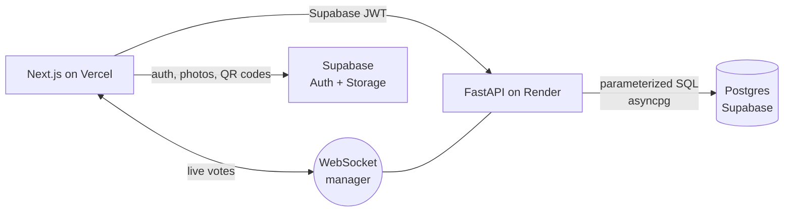

<h1 align="center">RushRank</h1>

<h3 align="center">Run fraternity recruitment from one app instead of five</h3>

<p align="center">
  Chapters meet hundreds of recruits in a week, then track them in spreadsheets,<br>
  vote on paper ballots, and count bids by hand. RushRank puts the recruit profiles,<br>
  event check-in, and the chapter-wide vote in one place that works from every member's phone.
</p>

<p align="center">
  <a href="https://rushrank.vercel.app">🌐 Live site</a> ·
  <a href="docs/FEATURES.md">📋 Feature guide</a> ·
  <a href="#-run-it-locally">🚀 Run locally</a>
  <!-- Once DEMO_USER_EMAIL / DEMO_USER_PASSWORD are set on the Render backend,
  add: · <a href="https://rushrank.vercel.app/demo">▶️ Try the read-only demo</a> -->
</p>

<p align="center">
  
  
  
  
</p>

<p align="center">
  <sub>
    🏛️ Piloted with the Chico Independent Interfraternity Council, Fall 2026 rush ·
    6 fraternities · 600 active members · 150 recruits
  </sub>
</p>

<!-- HERO: a live voting session — the swipe card on a phone next to the
results view. If one image, the swipe interface is the money shot; a short GIF
of swipe → tally updating is better. Use the seeded demo chapter
(python_server/create_demo_data.py), never real recruits' photos or names.
Save as docs/media/demo.gif (keep under 5MB) and replace this comment with:
<p align="center"></p>
-->

---

### Menu

- [Features](#-features)
- [The problem](#-the-problem)
- [How it works](#-how-it-works)
- [Run it locally](#-run-it-locally)
- [Scope and non-goals](#-scope-and-non-goals)
- [Tradeoffs](#-tradeoffs)
- [Known limitations](#-known-limitations-and-failure-modes)
- [What I'd do next](#-what-id-do-next)
- [Stack](#-stack)

---

## ✨ Features

- **Recruit dossiers** — photos, tags, notes, and a public intake form recruits fill in themselves
- **QR check-in** at every rush event, so attendance is recorded instead of remembered
- **Live swipe voting** — the chair opens a session and the whole chapter votes from their phones, with results updating in real time
- **Server-enforced cutoffs and voting rounds** that narrow the list toward bid night
- **Bid lists and exports** — CSV for analysis, PPTX slideshows and PDFs for bid meetings
- **Roster import** to get a chapter's members in without retyping them
- **Hard chapter isolation** — every query is scoped to one chapter

---

## 🧩 The problem

Fraternity rush runs on spreadsheets, paper ballots, and group chats. Across
a rush week a chapter meets hundreds of potential new members (PNMs); who came
to which event, what brothers actually thought, and the final vote all live in
different places, and bid night ends with manual counting.

I first built RushRank for my own chapter. Before the Chico pilot I
interviewed people in its chapters to find which manual steps hurt most, and
those interviews set what got automated: PNM dossiers with photos and tags, event
attendance by QR code, and a voting session the whole chapter runs from
their phones while the chair drives.

---

## 🔧 How it works



- **Two services, one database.** A Next.js frontend (Vercel) and a FastAPI
  backend (Render), with Supabase providing Postgres, auth (password and
  magic-link), and storage for PNM photos and QR codes. The backend verifies
  Supabase JWTs against JWKS and queries Postgres directly.
- **No ORM.** Every query is hand-written parameterized SQL over asyncpg. The
  schema is 14 sequential SQL migrations; CI applies all of them to an empty
  Postgres on every push, then runs unit and integration tests against it.
- **Live voting.** The chair opens a session, members vote on a swipe
  interface, and updates fan out over a WebSocket manager that keeps
  per-session connection sets in memory. Votes land in Postgres; tallies,
  round results, and cutoffs read from there.
- **Tenant isolation.** Every table is scoped by `chapter_id`, enforced in the
  API layer. Postgres row-level security is not enabled in the committed
  migrations — the policy scaffolding is there, commented out.

---

## 🚀 Run it locally

Requirements:

- [Node 20+](https://nodejs.org/)
- [Python 3.11+](https://www.python.org/downloads/)
- A [Supabase](https://supabase.com) project

Apply `supabase/migrations/*.sql` in numeric order against your database
first — the migrations directory is the single source of truth.

```bash
# backend — env in root .env: DATABASE_URL, SUPABASE_URL,
#   SUPABASE_ANON_KEY, SUPABASE_SERVICE_ROLE_KEY, SUPABASE_JWKS_URL
pip install -r python_server/requirements.txt
python run_fastapi.py        # http://localhost:8000 (API docs at /docs)

# frontend — env in frontend/.env.local: NEXT_PUBLIC_SUPABASE_URL,
#   NEXT_PUBLIC_SUPABASE_ANON_KEY, NEXT_PUBLIC_API_BASE_URL
cd frontend && npm install && npm run dev   # http://localhost:3000
```

_**Note:** set `NEXT_PUBLIC_API_BASE_URL` with no trailing slash and no `/api`
— the client appends `/api`, and the live voting socket is derived by
stripping it back off._

`python_server/create_demo_data.py` seeds a demo chapter with users and PNMs
so you can click through a rush without inventing one.

**Tests:** `cd python_server && pytest -q -m "not integration"` runs the fast
mock-based suite; the `integration` marker needs a real Postgres.

---

## 🎯 Scope and non-goals

**In scope:** one chapter's rush cycle end to end — roster import, PNM
dossiers, events with QR attendance, live voting rounds with server-enforced
cutoffs, bid lists, and exports.

**Not in scope:**

- PNM-facing accounts. PNMs touch the system once, through a public intake
  form — there's no PNM login or status page (that's backlog, not product).
- Anything cross-chapter. Data is hard-scoped to one chapter; multi-chapter
  sharing is a roadmap idea, not a feature.
- Social-media scraping to auto-fill PNM profiles. Deliberately not built.

---

## 🔀 Tradeoffs

**Raw SQL instead of an ORM.** Full control and no hidden queries — and the
cost is documented in this repo's own audit (`docs/AUDIT-2026-08.md`): two
incompatible schema definitions coexisted for months, the mock-based unit
tests couldn't notice, and a production database matching neither committed
schema was the result. The fix was reconciling everything onto
migrations-only and making CI apply every migration to a fresh Postgres on
every push. The tradeoff stands, but now it has a guardrail.

**Authorization in the API layer instead of Postgres RLS.** Every query
filters on `chapter_id`; the RLS policies exist only as commented-out
scaffolding in the migrations. What it bought: one place to reason about
access, no policy plumbing between Supabase JWTs and the database. What it
cost: no safety net — a single forgotten `WHERE` clause is a cross-chapter
data leak, and only code review catches it.

---

## 🚧 Known limitations and failure modes

- WebSocket connections, the read cache, and rate-limit counters are all
  in-process. A deploy or restart mid-session drops every live voting
  connection — cast votes are safe in Postgres and clients reconnect, but
  the room notices. A second backend instance would split the state; the
  deployment is single-instance by design.
- Rate limits are keyed per IP, and a chapter votes from one venue's Wi-Fi.
  Forty phones behind one NAT share the vote endpoint's default budget of 30
  requests per minute. The limits are env-tunable, but the default would
  throttle a big room mid-session.
- The backend rides Render's cheap tier; a GitHub Action pings `/health`
  every 10 minutes to fight cold starts. That's the extent of ops — no
  metrics, no alerting, no error tracker.
- Most unit tests mock the database. The schema-drift class of bug is caught
  by CI's migration-apply step and integration tests, not the unit suite.
- Voting is attributable, not secret-ballot. An anonymous mode doesn't exist
  yet.

---

## 🧭 What I'd do next

1. **The multi-chapter pitch.** Self-serve signup works and a demo chapter
   can be seeded — what's left is the front door (marketing site, onboarding
   polish) to put in front of other chapters.
2. **Anonymous-ballot mode per session.** Votes are attributable today; a
   secret ballot for final rounds is the most obvious missing piece.
3. **A voter-participation panel for the chair** — who hasn't voted yet — to
   pair with the round cutoffs that already exist.
4. **A PNM-side status page** (magic-link, no account) so bid communication
   stops happening over group texts.

---

## 🧱 Stack

| Layer | Technology |
|---|---|
| Frontend | Next.js 14 · React 18 · TypeScript · Tailwind CSS — on Vercel |
| Backend | FastAPI · asyncpg · WebSockets — on Render |
| Data | PostgreSQL + Supabase (auth, storage) |
| CI | GitHub Actions — applies every migration to a fresh Postgres, then runs the test suite |

## About

Built by [Cole Hackman](https://colehackman.com).
